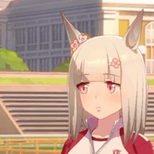
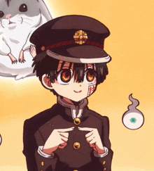
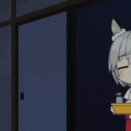
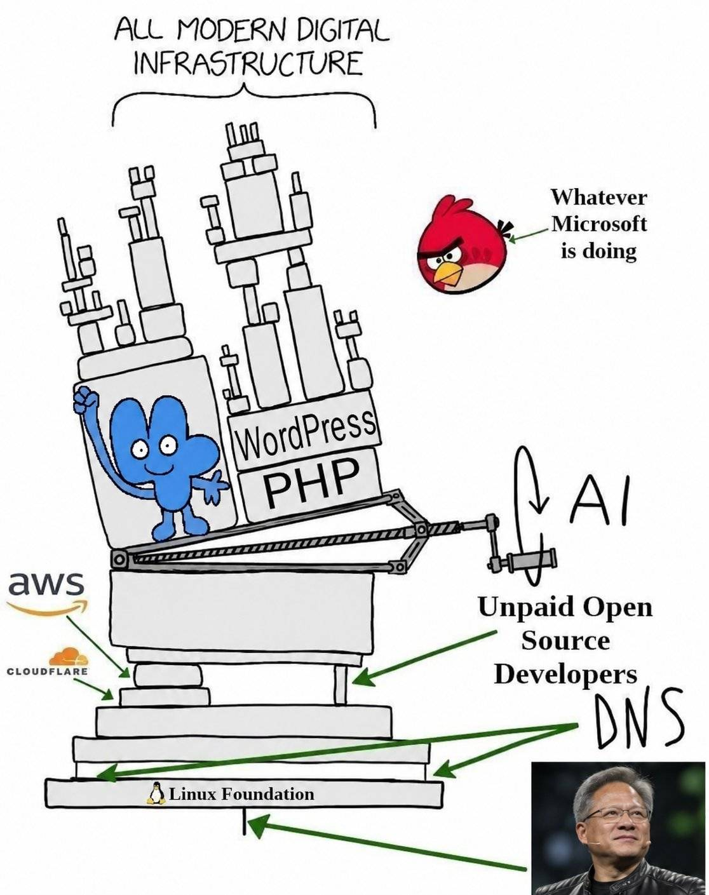

<div align="center">


<br/>


<br/><br/>


<a href="https://discord.gg/RCNMBCDswm"></a>
<a href="https://luau-obfuscator-api-seven.vercel.app/"></a>

</div>

<br/>

## 👋 About Me

<table>
<tr>
<td width="62%" valign="top">

I'm a **self-taught developer** who loves figuring out how things work under the hood.

- 🎮 Roblox development & **Luau** scripting
- 🛡️ Software protection, VMs & compiler architecture
- 🤖 AI engineering, reinforcement learning (Double DQN)
- 📱 Building software on mobile with **Termux**
- ☁️ Cloudflare Workers · Render · Supabase · REST APIs
- 🎥 Gaming & dev content on YouTube

</td>
<td width="38%" align="center" valign="middle">


</td>
</tr>
</table>

<div align="center">




<br/>


</div>

<br/>

## 🛡️ Featured Project — kkso882 Obfuscator

<div align="center">


<br/>

**A VM-based Luau / Lua obfuscator with a custom protection pipeline.**
<sub>Formerly *LuauShield* — rebuilt and rebranded as **kkso882 Obfuscator** (*kobfuscator*)</sub>

<br/>

[](https://luau-obfuscator-api-seven.vercel.app/)
[](https://luau-obfuscator-api-seven.vercel.app/api)


</div>

<table>
<tr>
<td width="50%" valign="top">

**⚙️ Core features**

- Custom VM-based compilation pipeline
- Opcode polymorphism
- String & constant protection
- Multi-layer protection
- Nested VM experiments
- Control flow transformation
- Lazy decryption
- Anti-tamper & integrity checks
- Validation & complexity endpoints

</td>
<td width="50%" valign="top">

**🎚️ Presets**

`Compact` → `Balanced` → `Heavy` → `Fortress` → `Insane`

**🧰 Built with**

`React 19` · `Vite` · `TypeScript` · `Express` · `Fengari` · `Vercel`

</td>
</tr>
</table>

<details>
<summary><b>⚡ Quick Start (click to expand)</b></summary>

<br/>

**Check API health**

```bash
curl https://luau-obfuscator-api-seven.vercel.app/api/health
```

**Send a script for processing**

```bash
curl -X POST https://luau-obfuscator-api-seven.vercel.app/api/obfuscate \
  -H "Content-Type: text/plain" \
  --data-binary @your_script.luau
```

</details>

<div align="center">

<br/>




</div>

<br/>

## 🚀 Projects

| | Project | What it is |
|:-:|---------|------------|
| 🛡️ | **kkso882 Obfuscator** | VM-based Luau / Lua code transformation & protection |
| 🎮 | **YooHub** | Roblox scripting tools, custom UI, key verification, script distribution |
| 🍚 | **Riceberry-UI** | Open-source dark-themed UI library for Roblox mobile |
| ⚡ | **Speed++** | Experimental language exploring high-performance design |

<div align="center">


<br/>





</div>

<br/>

## 🧠 Tech Stack

<div align="center">

**Languages**


**Frameworks & Tools**


<br/><br/>


</div>

<br/>

## 📊 GitHub Stats

<div align="center">


</div>

<br/>

## 😂 Infrastructure Meme

<div align="center">



</div>

<br/>

## 🤝 Looking for Teammates

<div align="center">


</div>

<br/>

I'm building **kkso882 Obfuscator** mostly on my own, and the codebase has grown bigger than one person can keep up with. If you're into any of these, let's talk:

- 🔧 **Luau internals** & VM design
- 🧬 **Compiler** / bytecode transformation
- 🎨 **Frontend** (React / TypeScript)
- 🔐 **Security** & reverse engineering

<div align="center">

[](https://discord.gg/RCNMBCDswm)

<br/>


<br/><br/>

*Building projects, learning continuously, and exploring what's possible.*

<br/>

**Interested in collaborating on kkso882 Obfuscator and other developer tools.**

<br/>

### 💬 Discord Server

[](https://discord.gg/RCNMBCDswm)

<br/>

[https://discord.gg/RCNMBCDswm](https://discord.gg/RCNMBCDswm)

<br/>


</div>
